# PACK-10 · Espace dossier : rapport d'admissibilité, validation et dépôt des documents (phase 2)
_Consigne pour Claude Code. Projet : plateforme Next.js (App Router, FR/EN) sur Vercel. **Prérequis : PACK-08 appliqué** (étapes du dossier, page `/suivi`, admin `/admin/dossiers`). PACK-02 recommandé (recommandations automatiques)._

## Le principe en une phrase
Après l'analyse gratuite, chaque étudiant reçoit sur WhatsApp **un lien personnel unique**. Il ouvre son **Espace dossier**, sans compte et sans mot de passe. Il y trouve trois onglets :
1. **Mon rapport** : les 3 ou 4 offres proposées par le conseiller, avec un bouton « Je valide ».
2. **Mes documents** : la liste des pièces demandées pour **son** cursus et **son** offre. Il les envoie depuis son téléphone (photo ou PDF), et voit le statut de chacune.
3. **Mon suivi** : l'étape du dossier (PACK-08).

Le parent peut suivre l'avancement **en lecture seule** avec le code dossier et les 4 derniers chiffres du WhatsApp (page `/suivi`).

## Parcours complet

```mermaid
flowchart LR
  A[Formulaire gratuit] --> B[Analyse par le conseiller]
  B --> C[Rapport publié<br/>3-4 offres]
  C -->|Lien WhatsApp| D[Étudiant : Je valide]
  D --> E[Paiement tranche 1<br/>confirmé par l'admin]
  E --> F[Onglet Documents ouvert<br/>checklist générée]
  F --> G[Étudiant envoie ses pièces]
  G --> H[Équipe : Validé / À refaire]
  H --> I[Odysseo prépare CV, lettres,<br/>traductions]
  I --> J[Étudiant valide les documents préparés]
  J --> K[Candidatures déposées<br/>suite PACK-08]
```

## Contexte et choix (à respecter)
- **Pas de compte** : un lien « magique » personnel, envoyé sur WhatsApp. C'est le plus simple pour un étudiant ou un parent qui utilise surtout son téléphone.
- **Sécurité adaptée à des passeports** : jeton aléatoire, 4 derniers chiffres du WhatsApp demandés à la première ouverture sur un nouvel appareil, fichiers stockés en **privé** et jamais accessibles par une URL publique.
- **Moins de stress pour l'étudiant** : la checklist est séparée en « À fournir maintenant » et « Plus tard » (casier, certificat médical, relevé bancaire). Il ne voit que ce qui le concerne.
- **Mobile d'abord** : prise de photo directe avec l'appareil, compression automatique, conseils courts sous chaque document.

## Tâches

### Lot A · Accès à l'Espace dossier
1. **Explorer d'abord** : le stockage des dossiers, l'admin du PACK-08, la gestion des variables d'environnement, l'envoi d'e-mails s'il existe.
2. **Jeton d'accès** : à la création du rapport (lot B), générer un jeton aléatoire de 32 octets (encodage base64url). Ne stocker en base que son **hachage SHA-256**. Le lien est `/{locale}/espace/{jeton}`. Validité : 180 jours [À VALIDER]. L'admin peut **régénérer** le lien (l'ancien ne marche plus) ou le **révoquer**.
3. **Première ouverture sur un appareil** : demander les 4 derniers chiffres du WhatsApp. En cas de succès, poser un cookie `httpOnly`, `secure`, `sameSite=lax`, valable 30 jours, lié au dossier. 5 essais maximum par heure. Message d'échec générique.
4. Page en `noindex`, absente du sitemap, sans outil de mesure marketing (pas de Pixel Meta dans l'Espace).

### Lot B · Rapport d'admissibilité et validation
5. **Admin** : sur la fiche d'un dossier, bouton « Préparer le rapport ».
   - Pré-remplir avec les recommandations du PACK-02. Le conseiller peut ajouter ou retirer des offres (2 à 4, choisies dans le catalogue `offres_2027.json`), changer leur ordre et le rôle de chacune (ambitieuse / cible / sécurité), et écrire un commentaire personnel (500 caractères maximum).
   - Choisir le cursus facturé (langue, bachelor, master, phd).
   - Bouton « Publier le rapport » : crée le jeton et passe l'étape du dossier à `analyse` → `rapport_envoye` (nouvelle étape à ajouter entre `analyse` et `ouvert` dans la liste du PACK-08).
   - Bouton « Copier le message WhatsApp » (modèle 1 de `messages_whatsapp.md`).
6. **Onglet « Mon rapport »** (côté étudiant) :
   - « Bonjour [Prénom], voici les offres que nous vous proposons » + le commentaire du conseiller.
   - Une carte par offre, **noms masqués** (même rendu qu'au PACK-02) : rôle, « Université *** – lieu », arguments, langue, durée, date limite.
   - Le tarif du cursus et les étapes de paiement, **lus depuis les données de tarifs du site** (comme au PACK-07). Pas de montant en dur.
   - Une case « J'ai lu et j'accepte les conditions générales » (lien vers `/conditions-generales`) et un bouton **« Je valide mon dossier »**.
   - À la validation : enregistrer la date, l'heure, l'adresse IP et la version du rapport. Passer l'étape à `valide_attente_paiement` (nouvelle étape) et afficher « Merci ! Votre conseiller vous envoie les instructions de paiement sur WhatsApp. »
   - Bouton secondaire : « J'ai une question », vers WhatsApp avec le code dossier.
7. **Admin** : bouton « Paiement tranche 1 reçu » (avec date et montant saisis à la main). Il passe l'étape à `ouvert`, **génère la checklist** (lot C) et propose de copier le modèle 2 de `messages_whatsapp.md`. Aucune intégration de paiement dans ce pack.

### Lot C · Checklist et dépôt des documents
8. **Génération de la checklist** à partir de `documents_requis.json` :
   - Liste de base = `base_par_cycle[cursus]`.
   - Pour chaque offre retenue dans le rapport validé, appliquer `ajouts_par_offre[ref]` : ajouter des documents, en rendre obligatoires, et afficher les notes.
   - Enlever les doublons et trier : « À fournir maintenant » (`phase: maintenant`) puis « Plus tard ».
   - L'admin peut ajouter un document libre (titre + aide) ou en retirer un, dossier par dossier.
9. **Onglet « Mes documents »** :
   - En haut : barre de progression « 4 documents sur 9 validés » et rappel de la prochaine date limite si elle est connue.
   - Pour chaque document : libellé, aide courte, badge d'état, bouton **« Prendre une photo »** (`<input type="file" accept="image/*" capture="environment">`) et bouton **« Choisir un fichier »** (PDF ou image). Plusieurs fichiers possibles par document (ex. relevés de 3 années).
   - Avant l'envoi : compression des images côté client (côté le plus long 2 000 px, qualité 0,8) ; refus si la taille dépasse `taille_max_mo` ou si le format n'est pas accepté. Message clair dans les deux cas.
   - Question à l'envoi : « Langue du document : Français / Anglais / Chinois / Autre ». Si Français ou Autre, créer automatiquement une tâche « Traduction » côté admin.
   - Pour `passeport` : demander aussi la date d'expiration. Afficher une alerte si elle tombe moins de 6 mois après la rentrée (septembre 2027 par défaut, ou la date de rentrée du dossier).
   - Pour `recommandants` (`type: formulaire`) : formulaire de 2 personnes, sans fichier.
   - États : `a_fournir` → `recu` → `valide`, ou `a_refaire` avec le commentaire du conseiller bien visible (ex. « Photo floue, reprenez à la lumière du jour »). L'étudiant peut remplacer un fichier tant qu'il n'est pas `valide`.
   - Section « **Préparés par Odysseo** » (liste `prepares_par_odysseo[cursus]`) : CV, lettre de motivation, plan d'études ou projet de recherche, traductions. L'équipe y dépose les versions finales. L'étudiant peut les télécharger et clique « Je valide » ou « Demander une modification » (avec un commentaire).
10. **Stockage des fichiers** :
    - Stockage **privé** obligatoire. Si le projet utilise déjà Supabase : Storage avec un bucket privé et des URL signées valables 5 minutes. Sinon : stockage compatible S3 (ex. Cloudflare R2), avec des URL pré-signées d'envoi et de lecture. Envoi direct du navigateur vers le stockage, pour ne pas dépasser les limites des fonctions Vercel.
    - Nom des fichiers : `{code_dossier}/{document}/{AAAAMMJJ-HHMMSS}-{index}.{ext}`. Jamais le nom de fichier d'origine dans le chemin.
    - Vérifier le type réel du fichier (signature, pas seulement l'extension).
    - Journaliser chaque envoi, téléchargement et suppression (qui, quand, quel fichier).
11. **Admin, fiche dossier** :
    - Liste des documents avec aperçu (images et PDF) via URL signée. Boutons « Valider » et « À refaire + commentaire ». Bouton « Copier le message WhatsApp » (modèle 3 : liste des documents à refaire).
    - Bouton **« Télécharger tout (ZIP) »** : fichiers renommés `NOM_Prenom_{Document}_{n}.{ext}`, prêts à envoyer au partenaire.
    - Liste des tâches de traduction, avec une case « Fait ».
    - Vue « À traiter » sur la liste des dossiers : nombre de documents reçus non vérifiés, pour savoir où travailler en premier.
    - Notification à l'équipe : e-mail récapitulatif (un par heure au maximum) quand de nouveaux documents arrivent, si un service d'e-mail est déjà configuré. Sinon, un compteur dans l'admin suffit.
12. **Vue parent** (page `/suivi` du PACK-08, en lecture seule) : ajouter la progression « 4 documents sur 9 validés » et la liste des documents **avec leur seul état**. Ni fichier, ni aperçu, ni commentaire.
13. **Confidentialité** :
    - Avant le premier envoi de fichier, afficher une case à cocher : « J'accepte que mes documents soient conservés et transmis aux universités et à leurs partenaires pour ma candidature. »
    - Mettre à jour la page `/[locale]/confidentialite` : documents stockés de façon privée, accessibles uniquement à l'équipe Odysseo, conservés jusqu'à 12 mois après la fin du dossier puis supprimés [À VALIDER].
    - Créer une tâche planifiée (Vercel Cron) qui liste les dossiers `clos` ou `arrive` depuis plus de 12 mois, pour suppression après confirmation de l'admin.

### Lot D · Textes
14. Toutes les étiquettes en FR et EN. Ton simple et direct, phrases courtes. Texte ≥ 12 px, boutons ≥ 48 px de haut.

## Critères d'acceptation
- [ ] De bout en bout, avec un dossier de test : publier le rapport → ouvrir le lien sur un téléphone → saisir les 4 chiffres → « Je valide » → l'admin marque la tranche 1 reçue → la checklist apparaît.
- [ ] Un dossier Master avec MA-21 dans le rapport affiche « Vidéo de présentation » et un relevé bancaire **obligatoire** ; un dossier Master sans MA-21 n'affiche pas la vidéo.
- [ ] Photo prise depuis le téléphone, compressée, envoyée en moins de 10 secondes en 4G, et visible dans l'admin.
- [ ] Un PDF de 15 Mo est refusé avec un message clair ; un fichier `.exe` renommé en `.pdf` est refusé.
- [ ] Aucun fichier n'est accessible sans URL signée valide (tester une URL signée expirée).
- [ ] « À refaire » avec un commentaire : l'étudiant voit le commentaire et peut renvoyer le document.
- [ ] Le ZIP de l'admin contient tous les fichiers, bien renommés.
- [ ] La page `/suivi` (parent) montre la progression mais aucun fichier.
- [ ] Un lien régénéré invalide l'ancien lien.
- [ ] `npm run build` et tous les tests passent ; aucune régression sur `/postuler`, `/suivi` et `/admin`.

## Ne pas faire
- Pas de création de compte ni de mot de passe pour l'étudiant.
- Pas de paiement en ligne dans ce pack (ce sera un pack séparé : Mobile Money et carte).
- Pas d'URL publique de fichier, même « difficile à deviner ».
- Pas de nom réel d'université dans l'Espace dossier tant que le dossier n'est pas `ouvert`. **À partir de `ouvert`**, afficher le nom réel de l'université sur les cartes du rapport (lu côté serveur dans `offres_2027_internes.json`), puisque la charte prévoit de le communiquer à l'ouverture du dossier.

## Fin du pack
- Incrémenter la version mineure dans `package.json`. Ajouter l'entrée `PACK-10 Espace dossier (rapport, validation, documents)` dans `CHANGELOG.md`.
- Commit : `feat(espace): espace dossier par lien sécurisé, rapport, validation, dépôt et vérification des documents (PACK-10)`.

## À fournir ou décider par le fondateur
- [ ] Choix du stockage (si le projet n'utilise pas déjà Supabase) et création du compte : Cloudflare R2 ou équivalent.
- [ ] Durée de validité du lien (proposé : 180 jours) et durée de conservation des documents (proposé : 12 mois après la fin du dossier).
- [ ] Relecture des textes d'aide dans `documents_requis.json`.
